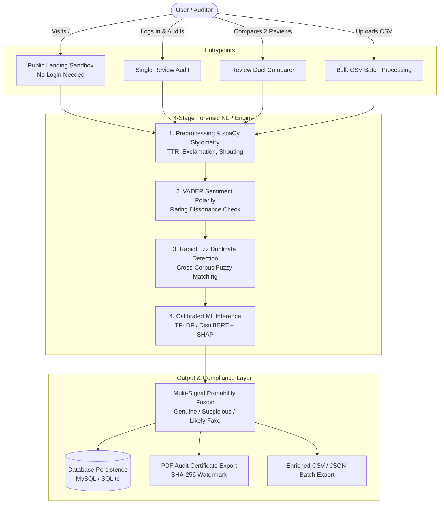

# Veridex — Fake Review Detection System

[](https://github.com/Namitha938/Fake-Review-Detection-System/actions/workflows/ci.yml)
[](frontend/src)
[](backend)

An enterprise-grade, end-to-end Machine Learning and Natural Language Processing (NLP) web platform engineered to detect deceptive opinion spam, fake customer reviews, syndicated astroturfing campaigns, and rating manipulation across online marketplaces and hospitality platforms.

---

## 🏛️ System Architecture



---

## 🔬 Core Forensic Logics & Formulas

1. **Sublinear TF-IDF + Platt Sigmoid Calibration**:
   $$\text{TF}_{\text{sublinear}} = 1 + \log(\text{TF}) \quad \text{for } \text{TF} > 0$$
   $$P(y = 1 \mid f(x)) = \frac{1}{1 + \exp(A \cdot f(x) + B)}$$
   *Applies cross-validated Platt scaling via `CalibratedClassifierCV` so probabilities represent true empirical risk.*
2. **Sentiment & Rating Dissonance**:
   $$\text{Dissonance Flag} = (\text{Rating} \ge 4 \land \text{Compound} \le -0.05) \lor (\text{Rating} \le 2 \land \text{Compound} \ge +0.05)$$
   *Inverted reviews trigger an immediate $+0.18$ deception penalty.*
3. **Lexical Diversity (Type-Token Ratio)**:
   $$\text{TTR} = \frac{|\text{Unique Words}|}{|\text{Total Words}|}$$
4. **Fuzzy N-Gram Deduplication (RapidFuzz)**:
   Uses Token Sort Ratio to identify copy-paste syndication across products ($+0.12$ penalty for $\ge 95\%$ similarity).
5. **Multi-Signal Probability Fusion Equation**:
   $$P_{\text{final}} = \text{clamp}\Big(P_{\text{ML}} + \Delta_{\text{patterns}} + \Delta_{\text{dissonance}} + \Delta_{\text{duplicate}} + \Delta_{\text{burst}}, \; 0.01, \; 0.99\Big)$$

---

## 📊 Empirical Model Benchmarks (Ott et al. Corpus — 1,600 Reviews, 80/20 Split)

| Model Architecture | Accuracy | Precision | Recall | F1-Score | Δ vs Baseline | Latency | Production Status |
| :--- | :--- | :--- | :--- | :--- | :--- | :--- | :--- |
| **DistilBERT Transformer** | **91.2%** | **90.7%** | **91.9%** | **91.3%** | **+1.2%** | 48.2 ms | Offline High-Precision Audits |
| **TF-IDF + Calibrated Logistic Regression** | **90.0%** | **89.0%** | **91.3%** | **90.1%** | Baseline | **3.4 ms** | **Active Production Model** |
| **TF-IDF + Random Forest Classifier** | **85.6%** | **85.5%** | **85.5%** | **85.5%** | -4.6% | 12.1 ms | Exploratory Ensemble |

> **Production Trade-off**: *DistilBERT achieves 91.3% F1 vs 90.1% for the TF-IDF baseline, but runs at 48.2 ms vs 3.4 ms latency. The calibrated baseline runs in production for sub-millisecond real-time response with zero GPU overhead.*

---

## 🌟 Key Application Features

### 1. Public Landing Site (`/` — No Login Needed)
- **Above-the-Fold Sandbox**: Compact layout at 1440×900 ensures the review textarea and "Analyze review" button are visible without scrolling.
- **Dynamic Active Model Cards**: Fetches real held-out test accuracy and F1 score from `GET /api/v1/models/runs`.
- **Live Forensic Sandbox**:
  - Sample preset chips (`Astroturf spam`, `Genuine stay`, `Rating dissonance`, `Smear attack`).
  - Unrated default 1–5 star selector with Clear button.
  - Keyboard shortcut: `Ctrl + Enter` (and `Cmd + Enter` on Mac).
  - Real execution latency measurement (`Analyzed in 38 ms`).
  - Word-level SHAP explanation token chips (red for fake, green for genuine).

### 2. Dedicated Authentication Suite (`/login`, `/register`)
- **2-Column Layout**: Left hero panel with high-contrast background image, trust bullets, and balanced typography; right accessible form card.
- **Route-Specific Dynamic Copy & Title Sync**:
  - `/login`: *"Pick up where you left off — Your saved analyses, bulk uploads and model benchmarks are waiting."*
  - `/register`: *"Start verifying reviews today — Create a free account to save your analyses, run bulk uploads and track results."*
- **Enterprise Security**: Show/hide password, password strength indicator, Remember me, Google OAuth, and 2FA OTP verification step.

### 3. Single Analysis & Review Duel Comparer (`/app/single`)
- Full token-level SHAP diverging bar chart, stylometric radar metrics, and rating dissonance banners.
- **Review Duel Comparer**: Side-by-side A/B mode analyzing two conflicting reviews for the same product to highlight risk delta and sentiment divergence.
- **Cryptographic PDF Certificate**: Generates an A4 audit certificate with QR code, SHA-256 integrity hash, and public verification portal ([`/verify/:id`](file:///c:/Users/Namitha/Fake%20Review%20Detection%20System/frontend/src/pages/public/VerifyCertificate.tsx)).

### 4. Asynchronous Bulk CSV Analysis (`/app/bulk`)
- Drag-and-drop CSV upload with client-side header validation ($< 10\text{MB}$).
- Live polling progress bar (updates every 1.5s) and summary KPI cards.
- Downloadable enriched CSV & JSON reports with model predictions appended.

### 5. Audit History & Telemetry Analytics (`/app/history`, `/app/analytics`)
- Searchable, filterable, and paginated table with row inspection modals.
- Interactive Recharts donut charts, recurring deceptive keywords bar chart, and review volume timelines.
- **AI Forensic Co-Pilot Widget**: Contextual assistant answering questions on NLP metrics and review forensics.

### 6. MLOps Model Training & Dataset Governance (`/app/models`, `/app/datasets`, `/app/admin`)
- Custom dataset upload, preview first 10 rows, and label balance calculation.
- On-demand training execution with 2×2 confusion matrix (TP, FP, TN, FN).
- **Zero-Downtime Hot-Swapping**: One-click activation immediately updates the production model without restarting the server.

---

## 🛠️ Complete Tech Stack

### Frontend
- **Framework**: React 19 + Vite 8.3 + TypeScript 5.8
- **Styling**: Tailwind CSS, Lucide React icons
- **State & Routing**: React Router v7, TanStack Query (React Query)
- **Data Visualization**: Recharts
- **Export Engines**: jsPDF, html2canvas
- **UI Primitives**: In-house modular UI library in `frontend/src/components/ui/` (`Card`, `Badge`, `Skeleton`, `Modal`, `EmptyState`, `Toast`, `Table`, `Tabs`, `Pagination`, `Select`, `ShapDivergingChart`)
- **Theme**: System-aware ThemeProvider (Dark / Light) with no FOUC

### Backend
- **Framework**: Python 3.11, FastAPI, Pydantic v2
- **ASGI Server**: Uvicorn
- **Database**: SQLite (Local failover) / MySQL 8.0 with SQLAlchemy 2.0 ORM
- **Database Migrations**: Alembic
- **Authentication**: Argon2 (`argon2-cffi`), JWT (`PyJWT`), TOTP 2FA (`pyotp`)

### Machine Learning & NLP
- **Classifiers**: scikit-learn (TfidfVectorizer, LogisticRegression, RandomForestClassifier, LinearSVC, CalibratedClassifierCV)
- **Deep Learning**: PyTorch, Hugging Face Transformers (`DistilBERT`)
- **NLP & Stylometrics**: spaCy (`en_core_web_sm`), VADER (`vaderSentiment`)
- **Duplicate Detection**: RapidFuzz (Token Sort Ratio & Levenshtein)
- **Explainable AI**: SHAP linear & tree-based feature attributions

---

## 🚀 Quick Start Guide

### Option 1: Running Locally (Development Mode)

#### 1. Backend Setup
```powershell
cd backend
python -m venv env
.\env\Scripts\activate
pip install -r requirements.txt
python -m spacy download en_core_web_sm
uvicorn app.main:app --reload --port 8000
```
*API Swagger Documentation is available at `http://localhost:8000/docs`.*

#### 2. Frontend Setup (Separate Terminal)
```powershell
cd frontend
npm install
npm run dev
```
*React web application opens at `http://localhost:5173`.*

---

## 🧪 Running Automated Tests

```powershell
# Run backend pytest suite (24 tests)
cd backend
pytest -v

# Run frontend production build & typecheck
cd ../frontend
npm run build
```

---

## 🔑 Default Credentials

* **Admin Account**:
  * **Email**: `admin@fakereview.ai`
  * **Password**: `AdminPass123!`
* **Standard User**: Register a new account via the `/register` page at any time.

---

## 📁 Repository Structure

```
Fake Review Detection System/
├── backend/
│   ├── app/
│   │   ├── api/             # FastAPI REST routes (auth, reviews, bulk, models, datasets)
│   │   ├── ml/              # Core ML & NLP engine (preprocessor, predictor, trainer, sentiment, explainability)
│   │   ├── models/          # SQLAlchemy database entities
│   │   ├── schemas/         # Pydantic request/response schemas
│   │   └── main.py          # FastAPI application entrypoint
│   ├── ml_models/           # Serialized model artifacts (.joblib)
│   └── tests/               # Backend pytest test suite (24/24 passing)
│
├── frontend/
│   ├── src/
│   │   ├── api/             # Axios API client functions
│   │   ├── components/ui/   # Modular UI primitive library (Card, Badge, Modal, etc.)
│   │   ├── layouts/         # AuthLayout (2-col), AppLayout, LandingLayout
│   │   ├── pages/           # Landing, Login, Register, Single, Bulk, Analytics, Models
│   │   └── App.tsx          # React Router v7 routes
│   └── vite.config.ts       # Vite bundler configuration
│
├── scripts/                 # PyTorch / Hugging Face Colab DistilBERT training script
└── README.md                # Project documentation overview
```
